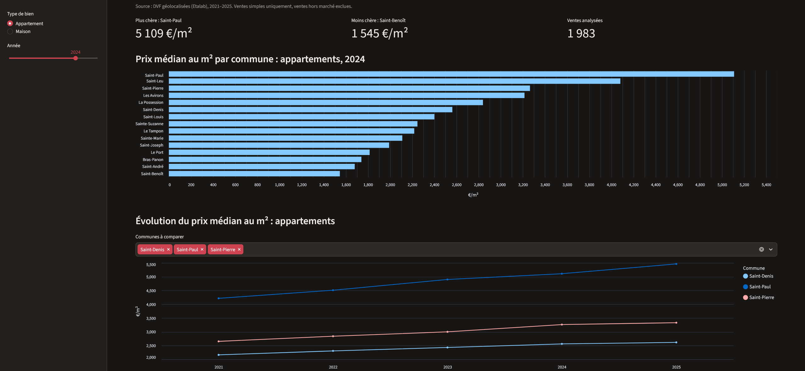
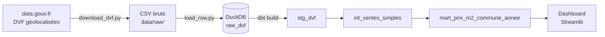
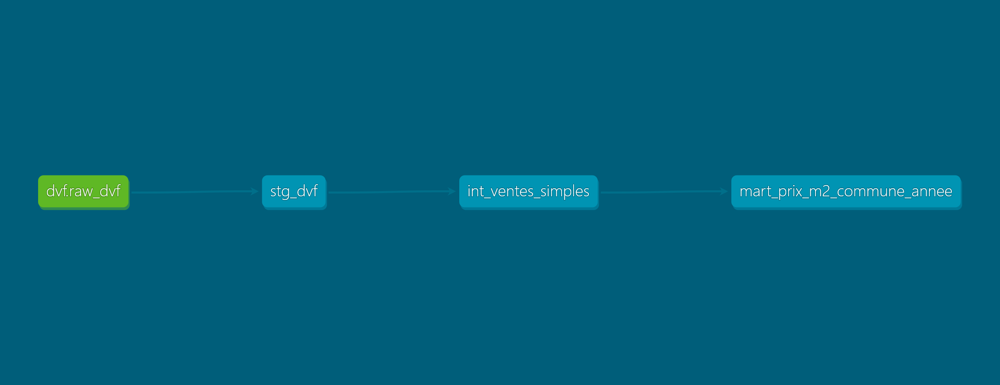

# Prix de l'immobilier à La Réunion : pipeline de données DVF


Ce projet calcule le **prix médian au m² de chaque commune de La Réunion**, de 2021 à 2025, à partir des données publiques de transactions immobilières (DVF). Les données sont téléchargées, chargées, nettoyées et testées par un pipeline automatisé, puis présentées dans un dashboard interactif.

Projet personnel réalisé pendant ma L3 MIAGE, pour me former au data engineering : ingestion, modélisation SQL avec dbt, qualité des données et intégration continue.



## Architecture



Le projet suit une approche **ELT** :

| Étape | Outil | Rôle |
|---|---|---|
| **Extract** | Python (`scripts/download_dvf.py`) | Télécharge les fichiers DVF de La Réunion (974) pour 2021–2025. Idempotent : les fichiers déjà présents ne sont pas retéléchargés. |
| **Load** | DuckDB (`scripts/load_row.py`) | Charge les CSV bruts, sans transformation, dans la table `raw_dvf`. |
| **Transform** | dbt | Nettoie et modélise les données en trois couches, avec 13 tests de qualité. |
| **Restitution** | Streamlit | Dashboard interactif qui lit la table finale. |
| **Orchestration** | `run_pipeline.py` + GitHub Actions | Lance tout le pipeline en une commande, automatiquement à chaque push et chaque mois. |

### Modèles dbt



| Modèle | Couche | Grain (une ligne =) | Rôle |
|---|---|---|---|
| `stg_dvf` | staging | une ligne DVF | Sélection des colonnes utiles et typage (dates, année). Aucune règle métier. |
| `int_ventes_simples` | intermediate | une vente simple | Ventes portant sur un seul logement, calcul du prix au m², signalement des ventes hors marché. |
| `mart_prix_m2_commune_annee` | mart | une année × une commune × un type de bien | Prix médian au m² et nombre de ventes, prêt pour le dashboard. |

## Stack technique

- **Python 3.13** : scripts d'ingestion et d'orchestration
- **DuckDB** : base analytique locale, sans serveur
- **dbt** (`dbt-core` + `dbt-duckdb`) : transformations SQL, tests et documentation
- **pandas** : exploration initiale des données
- **Streamlit + Altair** : dashboard interactif
- **GitHub Actions** : intégration continue

## Résultats clés

- **Saint-Paul est la commune la plus chère pour les appartements** : 5 108 €/m² en 2024 (médiane sur 224 ventes), soit plus de trois fois le prix de Saint-Benoît (1 545 €/m²).
- **Le prix médian des appartements a augmenté d'environ 24 %** entre 2021 et 2025 sur l'ensemble de l'île. Celui des maisons a progressé jusqu'en 2023, puis s'est stabilisé.
- **Le nombre de ventes a baissé de 28 %** entre 2022 et 2024 (de 5 792 à 4 174 ventes simples de maisons et d'appartements), sans faire baisser les prix des appartements. Une hypothèse possible : la hausse des taux d'intérêt a freiné le marché.
- **Un classement à lire avec prudence** : en 2025, Les Trois-Bassins arrive en tête des maisons, mais avec seulement 11 ventes. Une médiane calculée sur si peu de transactions est fragile.

## Qualité des données

### Le piège principal de DVF

Dans DVF, une vente portant sur plusieurs biens (par exemple deux appartements) apparaît sur **plusieurs lignes**, et le **prix total est répété sur chacune**. En 2024, une moyenne naïve sur les lignes brutes donne 2,66 M€, contre 273 000 € une fois chaque vente comptée une seule fois. Le projet ne retient donc que les **ventes simples**, pour lesquelles le prix correspond à un seul logement.

### Ce qui est filtré

Sur **102 551 lignes brutes**, le pipeline retient **25 864 ventes simples**, dont 521 sont signalées comme hors marché (moins de 500 €/m²). Elles ne sont pas supprimées de la table intermédiaire : elles sont **signalées** par une colonne `hors_marche`, puis exclues au moment du calcul. On peut ainsi toujours les retrouver et les analyser.

### Tests automatiques

13 tests dbt vérifient à chaque exécution :
- l'unicité et la présence de `id_mutation` dans `int_ventes_simples`, ce qui garantit qu'une vente n'est comptée qu'une fois ;
- qu'aucun prix au m² n'est nul ou négatif ;
- les valeurs autorisées de `type_local` ;
- l'unicité de la clé du mart (année, commune, type de bien) et l'absence de valeurs manquantes ;
- qu'aucune ligne du mart ne repose sur moins de 10 ventes.

Avec `dbt build`, si un test échoue, les modèles qui en dépendent ne sont pas construits : une donnée fausse ne peut pas atteindre le dashboard.

### Validation

Les résultats ont été obtenus de trois façons indépendantes : en **pandas** (notebook 01), en **SQL** dans DuckDB (notebook 02), puis avec le **pipeline dbt**. Les trois donnent exactement les mêmes chiffres.

## Méthodologie et limites

**Ventes retenues** : uniquement les ventes portant sur un seul logement (maison ou appartement), éventuellement avec ses dépendances (cave, parking).

**Ventes exclues** :
- les mutations qui ne sont pas des ventes classiques : échanges, adjudications, ventes sur plan (VEFA), ventes de terrain à bâtir ;
- les ventes symboliques, d'un montant inférieur à 1 000 € ;
- les ventes à moins de 500 €/m², considérées comme hors marché (ventes de parts, ventes familiales, logements sociaux revendus à leur locataire).

**Fiabilité** : une commune n'apparaît pour une année et un type de bien que si elle compte au moins 10 ventes.

**Limites** :
- **Le prix au m² ne tient compte que de la surface bâtie**, pas du terrain. Exemple réel : une maison de 50 m² sur 237 m² de terrain, rue des Sables à Saint-Gilles, vendue 1 500 000 €, soit 30 000 €/m² bâti.
- **Effet de composition** : si, une année, plus de ventes ont lieu dans les quartiers chers, la médiane augmente sans que les prix aient réellement monté.
- **Le neuf n'est pas pris en compte** : en excluant les VEFA, les chiffres reflètent surtout le marché de l'ancien.

## Lancer le projet

Prérequis : Python 3.13 et Git.

```bash
git clone https://github.com/assadakh/reunion-immobilier-data.git
cd reunion-immobilier-data
python -m venv .venv
```

Activer l'environnement virtuel :
- Windows : `.venv\Scripts\activate`
- macOS / Linux : `source .venv/bin/activate`

```bash
pip install -r requirements.txt
python run_pipeline.py
streamlit run app/streamlit_app.py
```

`run_pipeline.py` reconstruit tout depuis zéro (téléchargement, chargement, transformations et tests) en une dizaine de secondes.

Pour consulter la documentation dbt et le graphe de lignage :

```bash
cd dvf_dbt
dbt docs generate
dbt docs serve
```

## Structure du dépôt

```
reunion-immobilier-data/
├── .github/workflows/pipeline.yml   # Intégration continue (GitHub Actions)
├── app/streamlit_app.py             # Dashboard
├── data/                            # Données locales (non versionnées)
├── docs/                            # Images du README
├── dvf_dbt/                         # Projet dbt
│   ├── models/staging/              #   Nettoyage de la source
│   ├── models/intermediate/         #   Règles métier
│   ├── models/marts/                #   Tables finales
│   └── tests/                       #   Tests singuliers
├── notebooks/                       # Exploration (pandas, puis SQL)
├── scripts/                         # Extract et Load
├── requirements.txt                 # Dépendances (versions figées)
└── run_pipeline.py                  # Point d'entrée du pipeline
```

## Choix techniques

- **La médiane plutôt que la moyenne** : les prix immobiliers comptent des valeurs extrêmes (villas en bord de mer, ventes atypiques) qui faussent la moyenne. La médiane y résiste.
- **DuckDB** : une base analytique performante, contenue dans un seul fichier, sans serveur à installer. Elle convient bien à un volume de cette taille.
- **Signaler plutôt que supprimer** : les ventes suspectes sont marquées, et non effacées, pour pouvoir toujours les vérifier.
- **Des versions figées** : la première exécution en CI a échoué parce que GitHub avait installé une version plus récente de DuckDB, incompatible avec le code. Les dépendances du pipeline sont désormais figées dans `requirements.txt`.

## Pistes d'amélioration

- Utiliser `code_commune` plutôt que `nom_commune` comme clé du mart, pour permettre des jointures fiables avec d'autres sources (INSEE).
- Rendre visible la fiabilité de chaque commune dans le dashboard (par exemple des barres plus pâles quand il y a peu de ventes).
- Analyser l'évolution des prix par commune pour neutraliser l'effet de composition.
- Déployer le dashboard en ligne.
- Enrichir l'analyse avec d'autres sources ouvertes : revenus et population (INSEE), transports, météo.